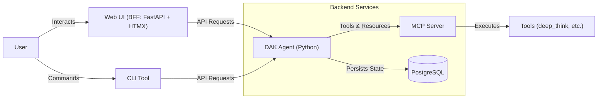

# Architecture Overview

The Decentralized Agent Kit (DAK) is designed to be a modular and extensible platform for building autonomous agents. It follows the Google Agent Development Kit (ADK) principles.

## Core Components

### 1. Agent Service (`agent/`)
The backend service responsible for:
- **LLM Integration**: Communicating with Large Language Models (Gemini, etc.) via `google-adk`.
- **State Management**: Storing conversation history and user context (PostgreSQL or In-Memory).
- **A2A Protocol**: Serving A2A 1.0 (and 0.3 for older peers) over JSON-RPC at `POST /a2a/dak_agent`, with the Agent Card at `GET /a2a/dak_agent/.well-known/agent-card.json` (see [a2a.md](a2a.md)).
- **MCP Server**: Exposing tools and resources via the Model Context Protocol.

### 2. BFF UI Service (`bff/`)
A lightweight FastAPI + HTMX web interface for interacting with the agent
(Backend For Frontend pattern), served at http://localhost:8002.
- **Chat Interface**: Streaming chat with the agent, including a "thinking process" view of tool calls.

### 3. CLI Tool (`cli/`)
A command-line interface for developers and power users.
- **Direct Access**: Interact with the Agent API from the terminal.
- **Automation**: Scriptable commands for agent tasks.


## Request log

The agent writes one `request` line per HTTP request to stderr, after a timestamp (`agent/dak_agent/request_log.py`). Where it goes after that (a log driver, CloudWatch) is the deployment's concern.

```
2026-10-15 05:21:40,512 request client=172.19.0.1 method=POST path="/run" status=200 ms=18282 app_name="dak_agent" user_id="demo-user" session_id="demo-session" approval_id=- mode=- trace_id=66f2695d902a8139364e749fbb8d3385
```

| field | source |
|-------|--------|
| `client` | the connection's peer address (`in-process` for the agent's own call from `/approvals/{id}/reply`; `X-Forwarded-For` is not read) |
| `method`, `path`, `status`, `ms` | the request and its response (for `/run_sse`, `ms` and `status` are those of the response start) |
| `app_name`, `user_id`, `session_id` | the path (`/apps/.../users/.../sessions/...`), else the body of `/run`, `/run_sse` and `/approvals/{id}/reply` (the ids the route acts on), else the query |
| `approval_id`, `mode` | `/approvals/{id}/reply` only: the path's id and the body's `mode` (`once` / `always` / `reject`) |
| `trace_id` | the trace opened for the request (32 hex digits) |

Never logged: the prompt or any body, session state / `state_delta`, tool arguments, a question's answer, a `reason`. Values the caller chooses (`path`, `app_name`, `user_id`, `session_id`, `approval_id`) are written as JSON strings, so a newline or quote cannot forge a line or a field. The caller's `traceparent` is not the parent of the trace: the agent starts it.

### Matching with tool calls

The ADK run and its tool calls are children of the request's trace, so the `trace_id` of a `request` line is the `trace_id` of the agent's `tool_call name=... trace_id=...` lines (`agent/dak_agent/permission.py`) and of the mcp-server's `tool_call` lines (#634, format in `mcp-server/README.md`). To follow one request:

```bash
docker compose logs agent mcp-server | grep 'trace_id=<id>'
```

## Infrastructure

- **Docker Compose**: Orchestrates all services (Agent, UI, Database).
- **PostgreSQL**: Provides persistence for conversation history.
